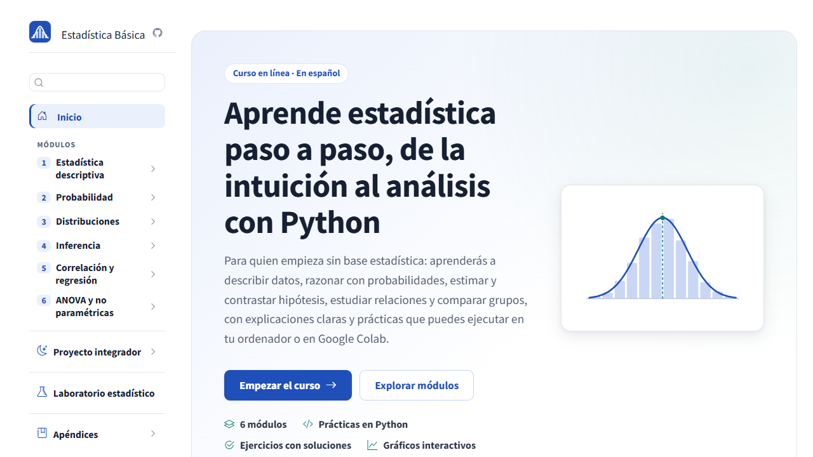

<div align="center">

 

# Estadística básica

Curso interactivo de estadística con Python, publicado como libro web: seis módulos de teoría y práctica, un proyecto integrador y una librería propia con tests.

[](https://juliouq.github.io/Curso-de-Estadistica-Basica/)

     

<sub>Ruta de ciencia de datos: **1. Estadística básica** → [2. Aprendizaje automático](https://github.com/JulioUQ/curso-aprendizaje-automatico) → [3. Deep learning](https://github.com/JulioUQ/curso-deep-learning)</sub>



</div>

---

## Descripción general

Curso práctico para aprender estadística desde cero. Cada módulo combina teoría con fórmulas y ejemplos, y un cuaderno de ejercicios con soluciones. Todo se apoya en `stats_toolkit`, una librería propia que implementa a mano los métodos con valor didáctico y compara sus resultados con `scipy` y `statsmodels`.

Es el primer paso de la ruta de ciencia de datos, que continúa con [aprendizaje automático](https://github.com/JulioUQ/curso-aprendizaje-automatico) y [deep learning](https://github.com/JulioUQ/curso-deep-learning).

## Contenido

| Módulo | Temas | Caso práctico |
| --- | --- | --- |
| 1. Estadística descriptiva | Tipos de variables, tendencia central, dispersión y forma | Salarios simulados; preprocesamiento de `sleephealth` |
| 2. Probabilidad | Probabilidad condicional, Teorema de Bayes, Naive Bayes | Filtro de spam simplificado |
| 3. Distribuciones | Bernoulli, binomial, Poisson, normal, exponencial, TCL | Tiempos de espera y conversión |
| 4. Inferencia | Intervalos de confianza, contrastes z y t, potencia, bootstrap | Cuatro preguntas sobre `sleephealth` |
| 5. Correlación y regresión | Pearson, Spearman, regresión lineal simple, R² | Publicidad y ventas; sueño y estrés |
| 6. ANOVA y no paramétricas | ANOVA, Tukey, chi-cuadrado, Mann-Whitney, Kruskal-Wallis, Wilcoxon | Tratamientos y segmentos de clientes |

Además: un **proyecto integrador** sobre los datos de sueño y tres **apéndices** (qué prueba usar, notación y glosario).

## Tecnologías y herramientas

| Ámbito | Herramientas |
| --- | --- |
| Publicación | Quarto (libro web), Mermaid, Observable JS |
| Cálculo | Python, NumPy, pandas, SciPy, statsmodels, matplotlib |
| Calidad | pytest, ejecución de las prácticas en CI |
| Despliegue | GitHub Actions y GitHub Pages |

## Estructura del proyecto

```text
.
├── _quarto.yml              # Configuración del libro
├── index.qmd                # Portada
├── notebooks/
│   ├── 01_estadistica_descriptiva/ … 06_anova_chi2/   # teoria.qmd + practica.ipynb
│   └── 07_proyecto_integrador/
├── apendices/               # Qué prueba usar, notación y glosario
├── src/stats_toolkit/       # Librería del curso
├── tests/                   # Tests de stats_toolkit
└── .github/workflows/       # deploy.yml (publica) y ci-check.yml (valida cada PR)
```

## Instalación y uso

Requisitos: [Quarto CLI](https://quarto.org/docs/get-started/) y Python 3.12 o superior.

```bash
git clone https://github.com/JulioUQ/Curso-de-Estadistica-Basica.git
cd Curso-de-Estadistica-Basica
python -m venv venv
source venv/Scripts/activate      # Windows (Git Bash); en macOS/Linux: source venv/bin/activate
pip install -r requirements.txt
quarto preview
```

Cada práctica tiene un enlace **Abrir en Google Colab**: su primera celda clona el repositorio e instala lo necesario, así que se puede seguir sin instalar nada.

Los cambios se trabajan en la rama `test` y llegan a `main` mediante pull request. El flujo `ci-check.yml` ejecuta los tests, las prácticas y el render antes de fusionar; `deploy.yml` publica el libro tras cada merge.

## Aspectos técnicos destacados

- Librería propia con tests que valida cada método frente a `scipy` y `statsmodels`.
- Integración continua que ejecuta todas las prácticas y comprueba que los datos procesados versionados coinciden con los regenerados.
- Prácticas ejecutables en local y en Google Colab con las mismas rutas.
- Gráficos interactivos con Observable JS integrados en Quarto.

## Autor

**Julio Úbeda Quesada** · Data Scientist

[](https://juliouq.github.io/Portfolio-Web---JulioUQ/es/) [](https://www.linkedin.com/in/juliouq/) [](https://github.com/JulioUQ)
